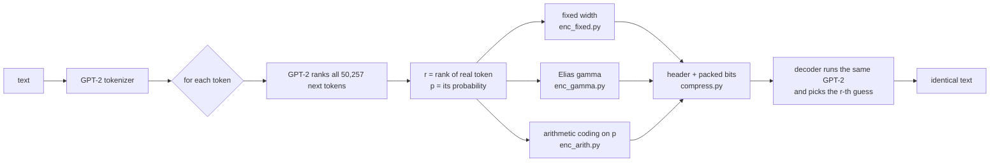
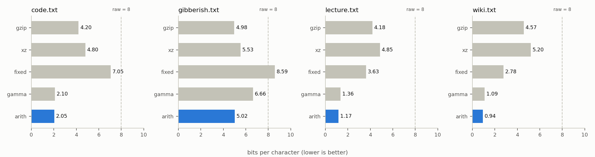
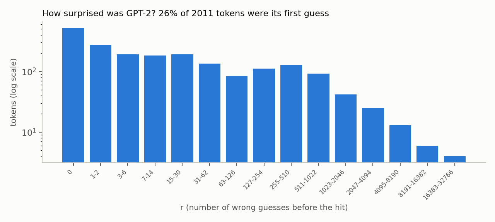

# Compression is Intelligence

A lossless text compressor built on GPT-2's next-token predictions.
If a model predicts text well, you only need to store *how wrong* it was, not the text itself.

## The idea

At each step GPT-2 ranks all 50,257 possible next tokens. We feed it the text so far and walk down its list:
write a `0` for every wrong guess and a `1` when it hits the real token.

```
"747 is Queen of" -> predictions: skies (97%) ...            -> hit on 1st guess -> 1
"... of skies"    -> predictions: "!" (80%), "and" (15%), "but" (2%) -> 0 0 1
stream so far: 1 001
```

r = number of wrong guesses before the hit (0 = first guess right).
p = probability GPT-2 gave the actual token.
The decoder runs the same model, so given the r list it picks the same tokens and rebuilds the text exactly.

## Pipeline



## Three ways to write the r stream

| Encoder | How | Cost per token |
|---|---|---|
| **fixed** | w = bits needed for the largest r. Header: w ones then a 0. Every r in w bits. | always w |
| **gamma** | n = r + 1, k = binary digits of n. Write k − 1 zeros, then n in binary. | 2·⌊log2 n⌋ + 1 (r = 0 costs 1 bit) |
| **arith** | Arithmetic coding with GPT-2's full probability distribution. | ≈ −log2 p (can be under 1 bit) |

## Results



| text | chars | tokens | gzip | xz | fixed | gamma | arith | ideal (Σ −log2 p) |
|---|---|---|---|---|---|---|---|---|
| wiki.txt | 1305 | 274 | 4.57 | 5.20 | 2.78 | 1.09 | **0.94** | 0.89 |
| lecture.txt | 1371 | 327 | 4.18 | 4.85 | 3.63 | 1.36 | **1.17** | 1.13 |
| code.txt | 1193 | 556 | 4.20 | 4.80 | 7.05 | 2.10 | **2.05** | 2.01 |
| gibberish.txt | 1500 | 854 | **4.98** | 5.53 | 8.59 | 6.66 | 5.02 | 4.98 |

Bits per character (raw text = 8). All runs verified lossless. Full table with timings: [assets/results.md](assets/results.md).



**What it shows**
- On normal English, arithmetic coding gets under 1 bit per character, about 5× smaller than gzip.
- Gamma gets most of the way there using only r.
- On random gibberish the model has nothing to predict, so it can't beat gzip. Compression really is prediction.
- Speed: about 20–40 ms per token, compressing and decompressing (CPU, measured in a Linux VM).

## Dead end: fixed width (kept on purpose)

`enc_fixed.py` was the first idea: one header for the whole file, then every r in w bits.
It fails because r is extremely skewed (see the histogram). Most tokens have small r, but a single surprising token
like "380" in "A380" (r = 1722) or "747" at the very start (r = 10899) forces w = 13–15 bits for **every** token,
including the ones the model got right first time. On gibberish it is bigger than the raw text.

The fix is the same header idea applied per token instead of once. That is exactly Elias gamma.

## Run it

```bash
python3 -m venv .venv && source .venv/bin/activate
pip install torch transformers matplotlib

python test_gpt2.py                          # Phase 0: top-5 guesses check
python rank_stream.py                        # Phase 1: rank stream round-trip
python enc_fixed.py; python enc_gamma.py; python enc_arith.py   # Phase 2 self-tests
python compress.py c input.txt out.bin arith # compress (fixed | gamma | arith)
python compress.py d out.bin back.txt        # decompress
python eval.py                               # Phase 4: table + plots into assets/
```

## Limits

- **The model is part of the decompressor.** GPT-2 small is ~500 MB, so this only pays off when both sides already have it.
- **Same machine/setup to decompress.** The decoder must reproduce GPT-2's numbers bit-for-bit; different hardware or library
  versions could swap two near-tied tokens and break decoding. CPU + float32 + stable sorting keeps it repeatable.
- **Slow.** One GPT-2 forward pass per token, both ways.
- **Small files favour us.** gzip/xz carry a fixed header of tens of bytes; on large files their numbers improve.
- GPT-2 only sees 1024 tokens, so the context restarts every 1000 tokens (`CHUNK` in `rank_stream.py`).

## Files

| File | Phase | What |
|---|---|---|
| `action_plan.md` | – | the plan this was built from |
| `test_gpt2.py` | 0 | prints GPT-2's top 5 next tokens |
| `rank_stream.py` | 1 | GPT-2 wrapper, text ↔ r list |
| `enc_fixed.py` / `enc_gamma.py` / `enc_arith.py` | 2 | the three encoders |
| `compress.py` | 3 | command-line compressor / decompressor |
| `eval.py` | 4 | benchmark, table and plots |
| `texts/` | 4 | test inputs |
| `assets/` | 4 | results table and charts |

Prior work on the same idea: LLMZip (Valmeekam et al., 2023), "Language Modeling Is Compression" (Delétang et al., 2023), and Fabrice Bellard's ts_zip.
